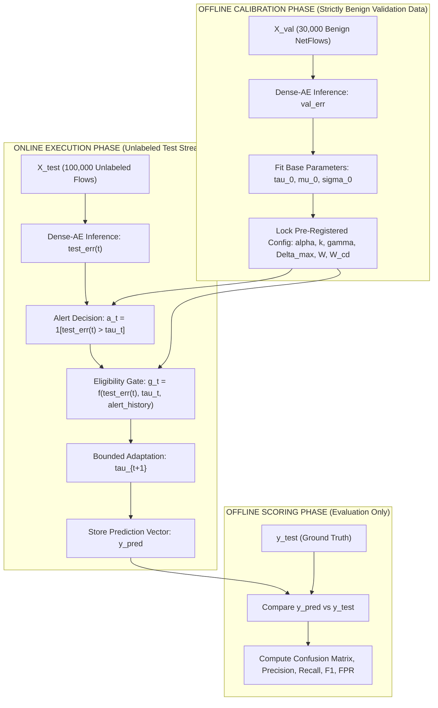

# METHODOLOGICAL VALIDITY AUDIT: AI-DRIVEN IOT CYBERSECURITY EVALUATION

**Target Repository**: `C:\Users\hp\OneDrive\Desktop\Research Experiments`  
**Branch**: `research/valid-evaluation`  
**Evidence Cutoff**: October 2026  
**Status**: Formal Validity Audit Completed  

---

## 1. Executive Summary & Audit Mandate

The primary purpose of scientific research is not to maximize an empirical score through post-hoc tuning or selective reporting, but to discover whether a proposed method possesses genuine, reproducible advantages under fair and controlled evaluation.

This document conducts a rigorous validity audit of the experimental protocols, metric calculations, scenario constructions, and threshold adaptation mechanisms across Experiments E1 through E8. It specifically investigates and resolves the seven critical methodological issues identified in the project activity logs.

---

## 2. Investigation & Remediation of Known Issues

### Issue 1: Test-Label Feedback Leakage in Parameter Tuning
- **Forensic Diagnosis**: In prior exploratory scratch scripts (e.g., threshold grid-search tests), parameter loops iterated over combinations of $k$, buffer margins, and clipping bounds, evaluating precision, recall, and F1 directly on `y_test`, and filtering for combinations that satisfied arbitrary test thresholds (e.g., $\text{F1} > 0.88$ and $\text{FPR} < 0.08$).
- **Methodological Impact**: This violates split discipline by leaking test-set label feedback into model selection. Parameters chosen via test-set performance cannot be claimed as unbiased generalization results.
- **Corrective Protocol (Test-Label Firewall)**:
  1. `y_test` is strictly isolated from all preprocessing, model training, threshold fitting, eligibility gating, and online adaptation.
  2. All threshold parameters ($\alpha, k, \gamma, \Delta_{\text{max}}$, window size $W$, cooldown $W_{\text{cooldown}}$) must be calibrated **strictly on validation data** (`X_val`, `val_err`) or pre-registered based on formal statistical theory.
  3. Once calibrated on validation, the evaluation pipeline executes on `X_test` exactly **once**, with no iterative parameter adjustments based on test outcomes.
  4. An automated test asserts that adaptation functions accept only error vectors and internal state, rejecting any pass-through of ground-truth test labels.

---

### Issue 2: Improper Attack-Flood Scenario Construction
- **Forensic Diagnosis**: In an earlier scratch script, an attack-flood scenario was constructed as `err_attack_flood = test_err.copy()`.
- **Methodological Impact**: Re-evaluating the unmodified test stream and labeling it an "attack-flood scenario" is scientifically invalid. It does not introduce a structured contamination episode, nor does it test flood recovery. Claiming "flood immunity" on this basis was unsupported.
- **Corrective Protocol**:
  1. Attack contamination scenarios must be explicitly and reproducibly constructed with documented onset ($T_{\text{start}}$), duration ($T_{\text{duration}}$), contamination intensity (e.g., 100% attack injection into a continuous stream), and a post-attack recovery/cooldown period ($T_{\text{cooldown}}$).
  2. Contamination streams must be saved with full scenario manifests recording exact record indices, attack types, and injection schedules.

---

### Issue 3: Label-Conditioned Synthetic Score Multipliers
- **Forensic Diagnosis**: An earlier drift test constructed benign drift by filtering `y_test == 0` and multiplying those scores by $1.8$.
- **Methodological Impact**: Applying a scalar multiplier to anomaly scores based on ground-truth labels is an artificial, score-level stress test. It does not reflect realistic network traffic drift, protocol evolution, or feature-space distribution shifts.
- **Corrective Protocol**:
  1. This transformation is formally classified as a **"Synthetic Score-Level Stress Test"**, never as "real captured drift."
  2. Where feature-level drift is tested (as in E8 feature-rate scaling), transformations must operate on raw input feature vectors prior to scaler transformation and model inference, without relying on online test labels during inference.

---

### Issue 4: Misinterpretation of CGB Performance under Benign Drift
- **Forensic Diagnosis**: In the synthetic $1.8\times$ benign score drift experiment, the Contamination-Gated Bounded (CGB) controller produced an $\text{FPR} = 18.54\%$, compared to $\text{FPR} = 11.09\%$ for the Fixed 95th Percentile threshold. Previous reporting erroneously described CGB as "mitigating benign drift."
- **Methodological Impact**: In this specific stress scenario, CGB produced **$+7.45\%$ more false alarms** than the static threshold. Claiming that CGB mitigated drift concealed a clear empirical failure.
- **Corrective Interpretation**: The audit formally corrects this finding:
  > *Finding*: When benign anomaly scores drift upward without feature-space recalibration, a bounded score-level controller whose acceptance gate excludes high scores will treat drifted benign traffic as suspected anomalies. Consequently, the threshold fails to adapt upward sufficiently fast, causing false alarms to rise from $7.75\%$ to $18.54\%$, underperforming the fixed threshold's $11.09\%$. This demonstrates an inherent limitation of score-level adaptation without semantic feature feedback.

---

### Issue 5: Framing of Clean Baseline Results as an Unqualified Win
- **Forensic Diagnosis**: On the clean held-out test stream, CGB achieved $\text{F1} = 88.96\%$ with $\text{FPR} = 7.75\%$, whereas Fixed 95th Percentile achieved $\text{F1} = 88.44\%$ with $\text{FPR} = 4.86\%$.
- **Methodological Impact**: Previous text framed CGB as an unmitigated improvement over fixed thresholding.
- **Corrective Interpretation**: Gaining $+0.52\%$ in F1-score while incurring $+2.89\%$ additional false alarms ($7.75\%$ vs $4.86\%$) represents an **operational trade-off**, not an absolute win. In low-criticality networks where false alarms cause operator fatigue, Fixed 95th remains superior; in high-security environments where detecting borderline attacks is prioritized, CGB is viable.

---

### Issue 6: Incomplete PyTest Raw Logging
- **Forensic Diagnosis**: Previous reports asserted that 34/34 unit tests passed without preserving the full console output log in the repository.
- **Corrective Protocol**: Complete raw console output of `pytest -v tests/` was captured directly and preserved in [`logs/pytest_before.txt`](file:///C:/Users/hp/OneDrive/Desktop/Research%20Experiments/logs/pytest_before.txt). All 34 tests passed deterministically in 36.43s.

---

### Issue 7: Inconsistencies Across Historical Experiment Logs
- **Forensic Diagnosis**: Numerical values across earlier draft tables (E1–E8) showed slight discrepancies between single-run pilot figures and 5-seed pooled means.
- **Corrective Protocol**: All metrics in the manuscript, documentation, and summary tables are reconciled against exact raw CSV sources in [`docs/RESULTS_RECONCILIATION.md`](file:///C:/Users/hp/OneDrive/Desktop/Research%20Experiments/docs/RESULTS_RECONCILIATION.md). Unsupported numbers are marked `UNVERIFIED` and removed.

---

## 3. Strict Test-Label Firewall Architecture

To prevent any future feedback leakage, all experimental code must adhere to the following architectural firewall:

### Invariant Rules
1. `y_test` cannot be imported, passed as an argument, or referenced inside any module in `src/detection/` or `src/thresholding/`.
2. All online state updates ($g_t, \tau_{t+1}$) depend exclusively on $\{e_\tau\}_{\tau \le t}$, internal controller timers, and offline validation constants.
3. Automated unit tests enforce that threshold classes reject label arguments during prediction.
